# OwlRocomAssistant

OwlRocomAssistant（ORA）是面向《洛克王国：世界》的本地数据助手。它将游戏实时状态、本地配置与收藏记录整理到统一界面中，帮助玩家查看精灵、探索、战斗、活动与个人收藏进度。

## 主要功能

- **精灵与图鉴**：同步队伍、盒位与精灵资料，支持体型、声音、性格、资质、特长、蛋组、外观、奖牌等多条件筛选与排序。
- **家园与背包**：查看种植、繁育、守卫、室内入住、物品、精灵蛋、货币和资产记录。
- **世界地图**：展示当前场景、附近精灵、采集资源、地图标记与捕捉统计，并提供目标关注和路线规划。
- **实时战斗**：呈现战斗模式、双方阵容、场上状态、技能、天气、伤害与战报。
- **活动与收藏**：汇总活动日历、花种、远行商人、异色日志和拼豆图纸。
- **多账号状态**：在同一界面中查看已配置账号的实时数据与历史记录。

## 界面预览

### 精灵

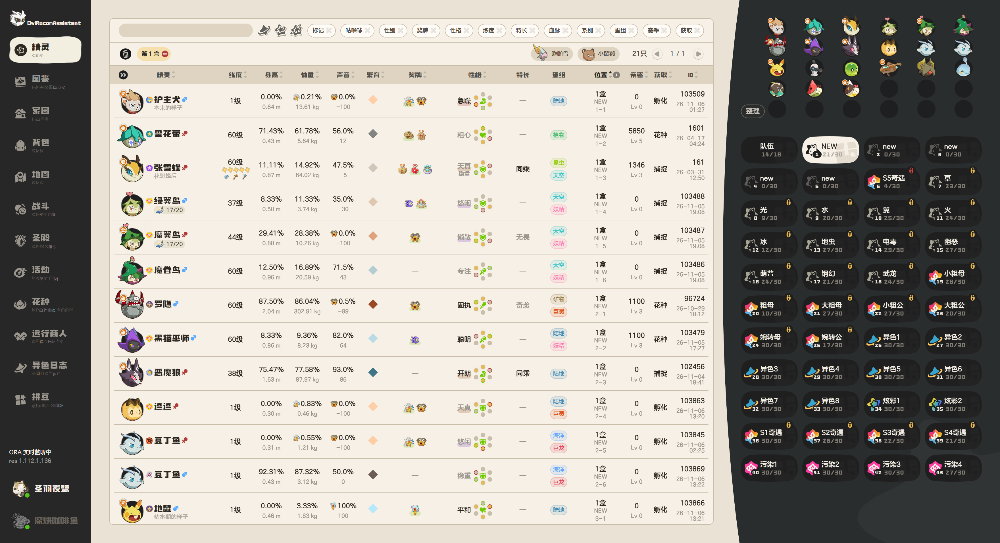

#### 多条件筛选

顶端筛选栏支持外观（异色、炫彩）、伙伴标记、咕噜球、性别、奖牌、性格、练度等条件。同组包含项满足任一项即可（OR），不同组条件同时满足；普通点击选中，`Shift + 点击`排除（NOT）。列表里的头像、球种、性别、性格、蛋组和盒位也可直接加入筛选。

| 炫彩细分                                                               | 咕噜球筛选                                                             |
| ---------------------------------------------------------------------- | ---------------------------------------------------------------------- |
| 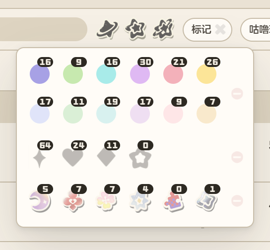  | 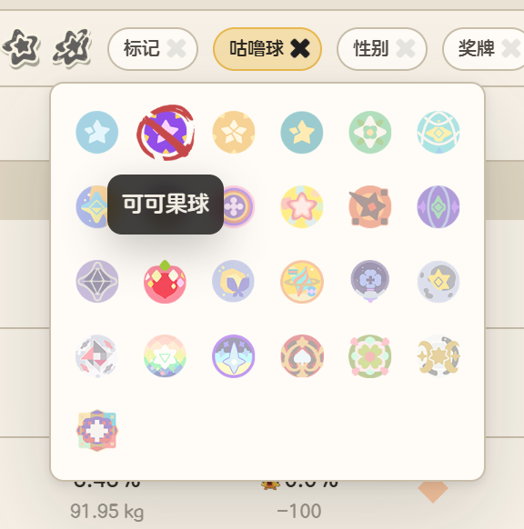 |
| 按颜色、粒子效果和赛季特殊外观细分，角标显示当前筛选结果中的对应数量。 | 按捕捉球种整理收藏，也可排除指定球种，再与家族、性别等条件组合。       |

#### 家族快捷筛选与常用性格

支持名称、全拼、首字母、具体形态和进化家族查找。按捕捉数量提供最多三个家族快捷按钮，默认统计今日，方便集中处理刚捕捉的精灵。

选中家族后，会参考最高常规进化阶段的对战使用率，显示常用性格快捷筛选。分支进化会分别参考各个进化末端，合并展示常用性格；悬停可查看对应精灵及使用率。

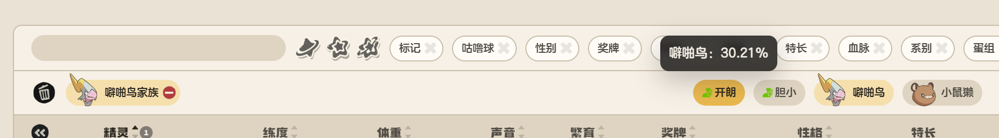

#### 列收起、排序与个体对比

身高、蛋组、亲密度和获取方式等次级列默认收起，需要时可统一展开。点击表头切换升降序，按住 `Shift` 追加排序条件，最多支持五级排序。

练度列集中显示等级、成长星和已用培养道具；性格列展示当前性格、原生性格与六维资质。体重、声音同时提供实际值和百分位，配合奖牌与排序，方便比较不同个体。

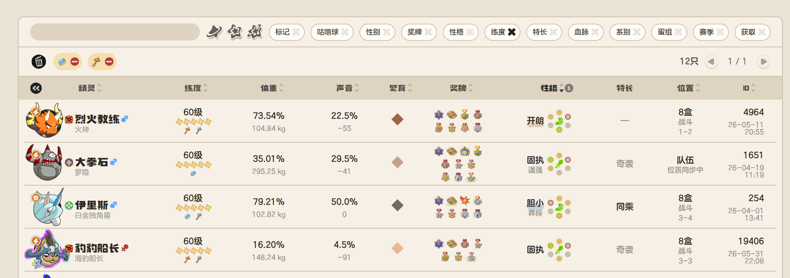

#### 进化进度与盒子整理

点击盒子的小锁，可按系别、赛季、体型、声音和性别设置整理规则，设置后显示金色小锁。开启“整理”后，会提示放错的精灵，并在位置列对照当前盒位与建议盒位，方便在游戏内整理。

**进化领果实提醒**：对于最高常规进化阶段尚未完成的 20 只果实课题，在可进化个体旁显示 `xx/20`，悬停可查看进化目标，帮助决定哪些精灵先留着进化。

**繁育个体替代**：盒子设有粗嗓或婉转繁育方向时，按设定方向比较同账号候选，标出“可替代”个体；悬停可查看替代者、体重与声音以及盒位，辅助决定保留对象。

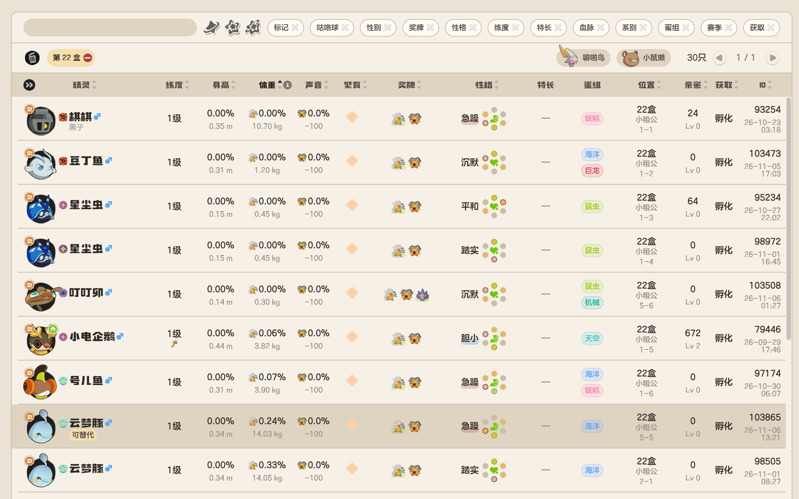

### 地图

实时展示附近精灵、赛季奇遇、采集物与地标，列表与地图位置联动。下方汇总消耗球数、成功捕捉和奇遇次数，并通过时间曲线回顾捕捉与奇遇记录。

#### S5 · 龙棋士

进入战斗前，可根据龙棋士的互动提示查看可能的性格；进战后显示第一层的实测性格。击破外层、揭示内部精灵后，再补全其实际性格、外观、体重和声音等信息，附带语音播报。

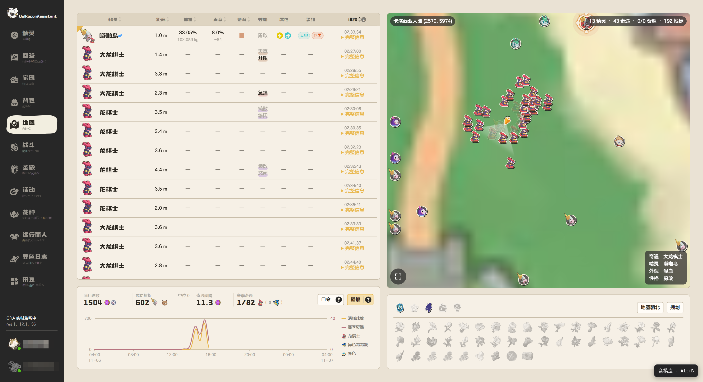

**隆重介绍奶龙模式，已经沉浸在自己的艺术中不可自拔了，之后将在网站中加入更多奶龙元素。**

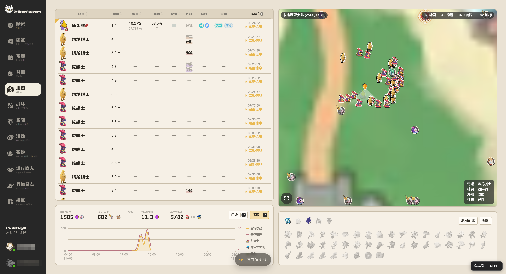

S4 · 月陨星与月陨流星雨

进入白月陨星战斗后，即可根据第一层生命查看疑似异色提示；读取信息后可以逃跑，探查结果会保留。已确认普通的白月陨星会改为灰色光晕，方便区分已探查与待探查目标。

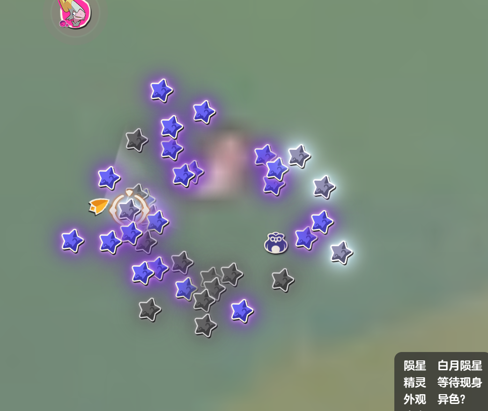

击破第一层生命后，地图标记会换成内部精灵的头像。悬停统计图表中的月陨流星雨图标，可查看该次流星雨的 20 只精灵明细。

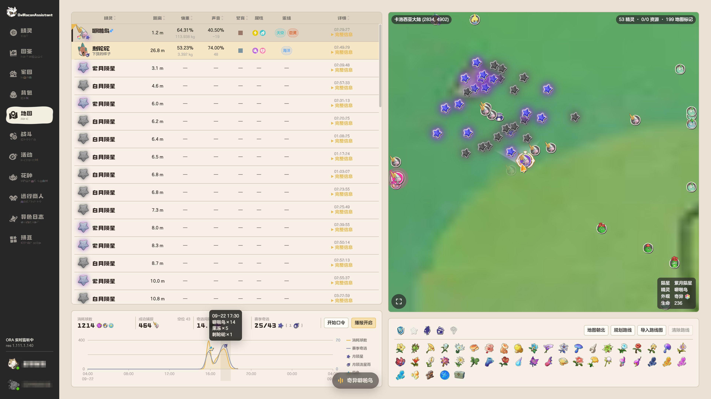

### 花种

花种与炫彩探查（S3 界面）

花种页汇总精灵与炫彩外观信息。自 S4 起，游戏内也提供了同类查看功能，ORA 的花种页可作为补充。下图为 S3 期间的界面。

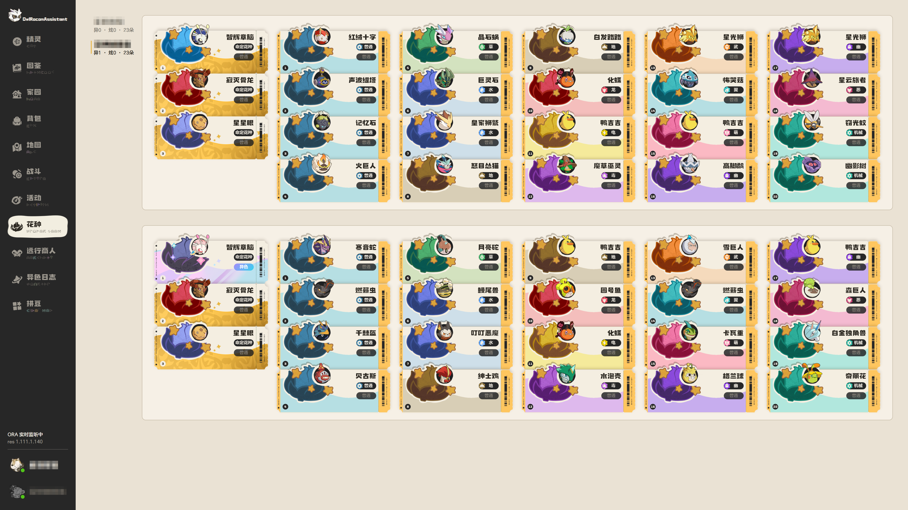

### 异色日志

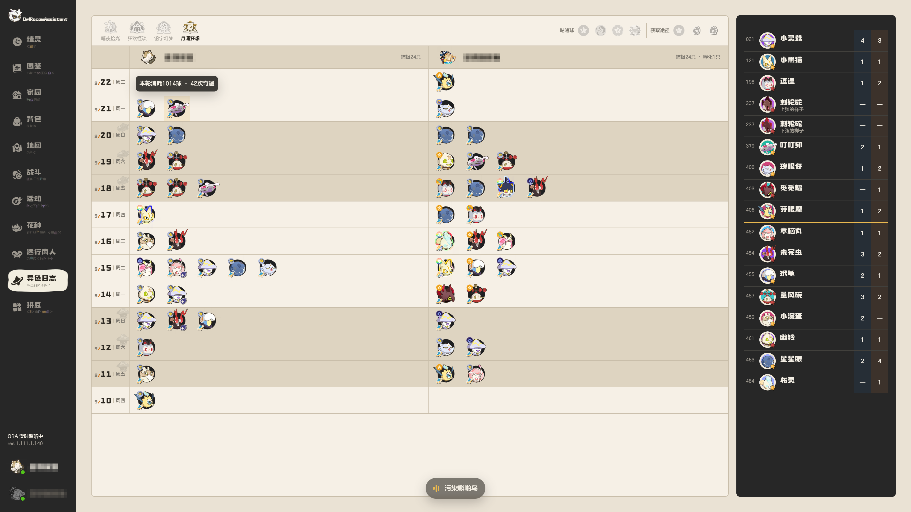

## 本地运行

ORA 在本机运行，页面、服务与实时协议监听均使用本地回环地址。账号配置、个人记录与协议缓存保存在用户自己的设备中。

## 项目状态

ORA 正在持续开发和完善。本仓库用于展示产品界面、功能进展与版本信息，项目开发仓库独立维护。

本项目为玩家制作的辅助工具，与《洛克王国：世界》官方无隶属关系。相关游戏名称、图像和商标归其权利人所有。

© 2026 benzoic-acid. All rights reserved.
