# OwlRocomAssistant

OwlRocomAssistant（ORA）是面向《洛克王国：世界》的本地数据助手。

## 主要功能

- **精灵、图鉴**：查找精灵资料，同步队伍与盒位，筛选、比较和整理个体。
- **家园、背包**：查看种植、繁育、守卫、室内入住、物品、精灵蛋、货币和资产记录。
- **地图**：展示附近精灵、采集资源、地标与捕捉统计，支持目标关注和路线规划。
- **战斗**：查看双方阵容、场上状态、技能、天气、伤害与战报。
- **圣殿**：查看草系徽章试炼的本轮构筑、事件候选与路线，回顾并保存冒险记录。

支持切换已配置账号，查看各自的实时状态与历史记录。

## 界面预览

### 精灵

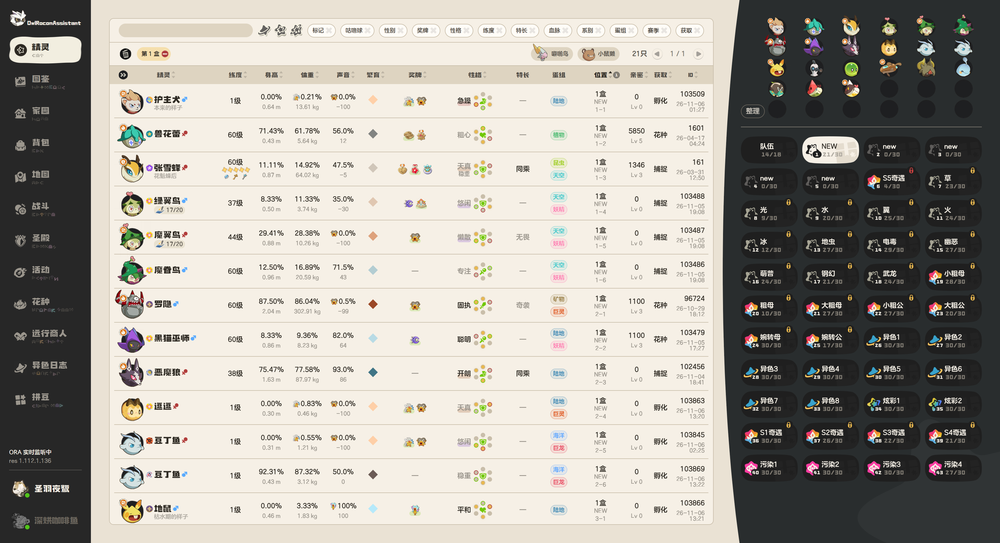

**搜索**：按名称、拼音、首字母或昵称搜索精灵及进化家族。例如，输入“彩蝶鲨”“fengling”“lds”或“啥子鱼”，均可找到风铃鲨家族。也可点击最近捕捉的家族快捷按钮；选中家族后，会提供常用对战性格，方便快速筛选。

**筛选**：按外观、球种、奖牌等条件缩小范围。使用 `Shift + 左键` 排除指定项（NOT）；炫彩颜色、奖牌、蛋组和系别默认匹配任一选中项（OR），使用 `Ctrl + 左键` 可要求同时满足选中项（AND）。

**进化获取果实提醒**：在可进化个体旁显示尚未完成的果实课题进度，提示用户放生前可先进化。

**繁育提醒**：通过“可替代”提示比较繁育候选，决定个体的保留与替换。

**分类整理**：点击盒子的小锁图标，按系别、赛季、体型、声音和性别设置分类规则。设置后小锁变为金色；开启“整理”后，会标记放错位置的精灵并显示建议盒位，协助整理。

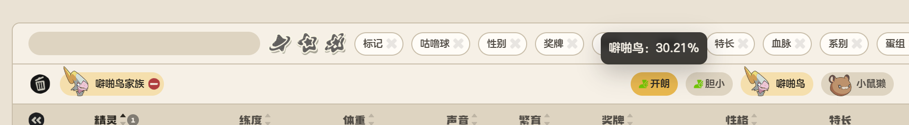

| 炫彩筛选 | 咕噜球筛选 |
| --- | --- |
| 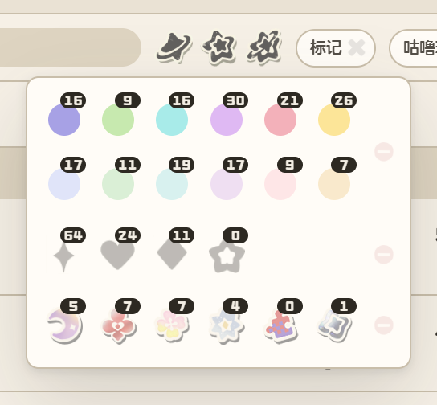 | 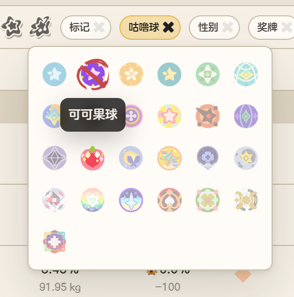 |

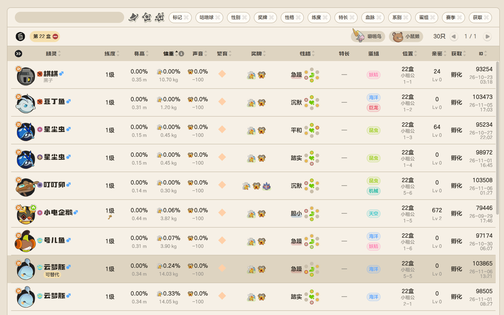

#### 操作演示

批量捕捉后，快速筛选声音达到极限值的精灵，以及性格、资质较优的个体。

[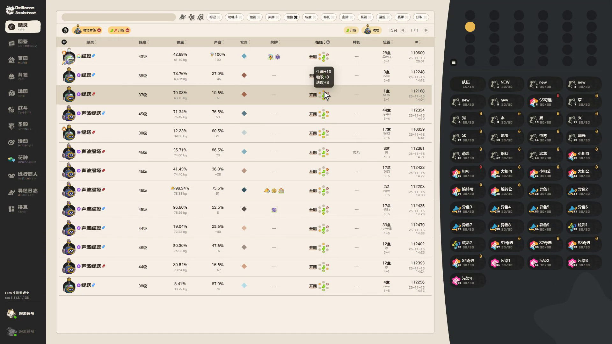](videos/pet-filter-demo.mp4)

[观看操作演示（MP4，约 28 秒）](videos/pet-filter-demo.mp4)

### 地图

实时展示附近精灵、赛季奇遇、采集物与地标，列表与地图位置联动。下方汇总消耗球数、成功捕捉和奇遇次数，并通过时间曲线回顾捕捉与奇遇记录。

#### S5 · 龙棋士

显示附近龙棋士与骰子的信息；进入战斗后，显示实测性格及异色状态，并提供语音播报。

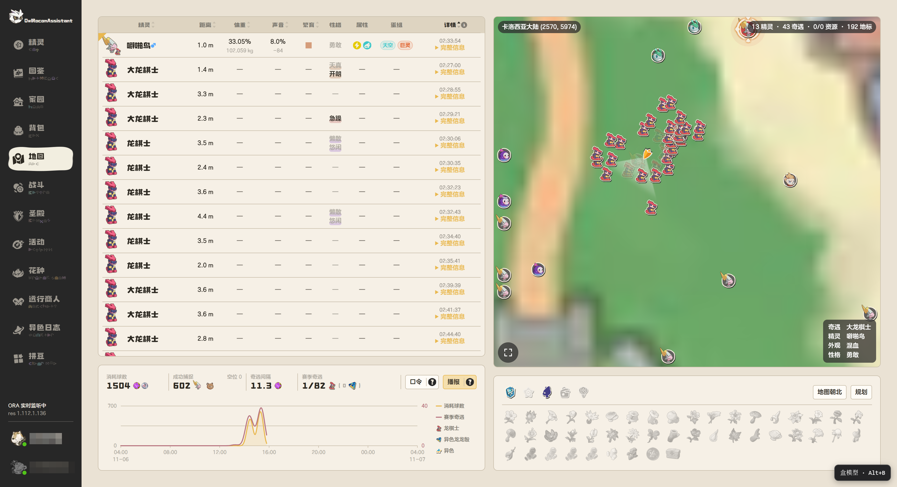

**隆重介绍奶龙模式！已经沉浸在自己的艺术中不可自拔了，之后还会在网站中加入更多奶龙元素。**

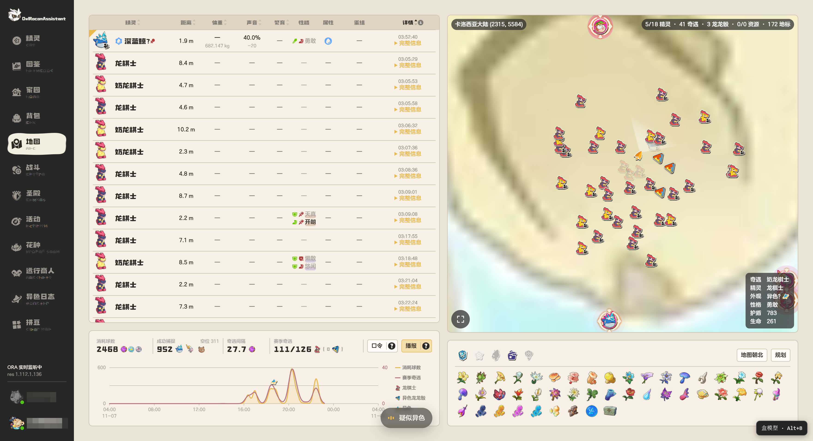

S4 · 月陨星与月陨流星雨

进入白月陨星战斗后，即可根据第一层生命查看疑似异色提示；读取信息后可直接逃跑。已确认非异色的白月陨星会改为灰色光晕，方便区分已探查与待探查目标。
击破第一层生命后，地图标记会换成内部精灵的头像。
悬停统计图表中的月陨流星雨图标，可查看该次流星雨的 20 只精灵明细。

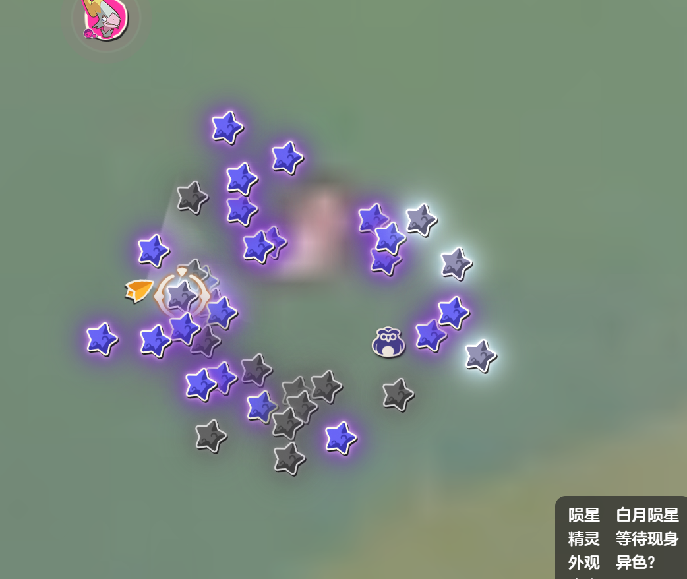

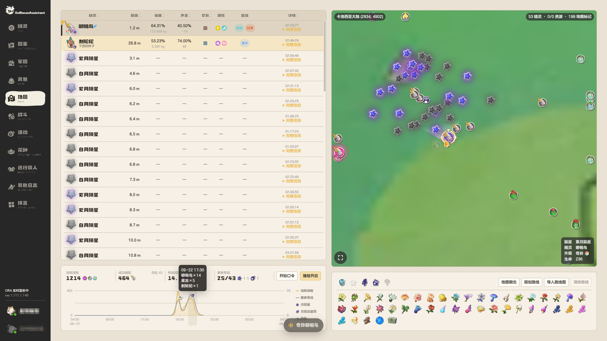

### 圣殿

**本轮冒险**：主要用于查看图鉴收集情况，策略规划还在寻思中。

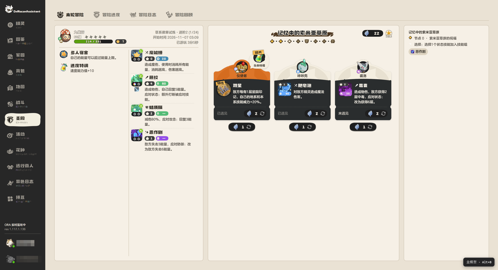

**冒险回顾**：用于保存爽局。

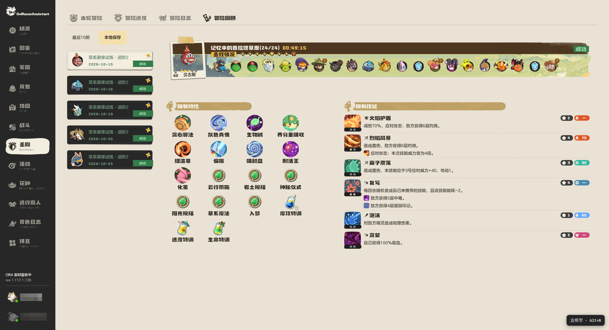

### 花种

花种与炫彩探查

原本用于在不进战的情况下探查炫彩花种；检测到特殊花种时，侧栏图标会相应变化，提示用户查看。
S4 起，游戏内已可直接从花种外观辨认异色或炫彩，该功能弃置。

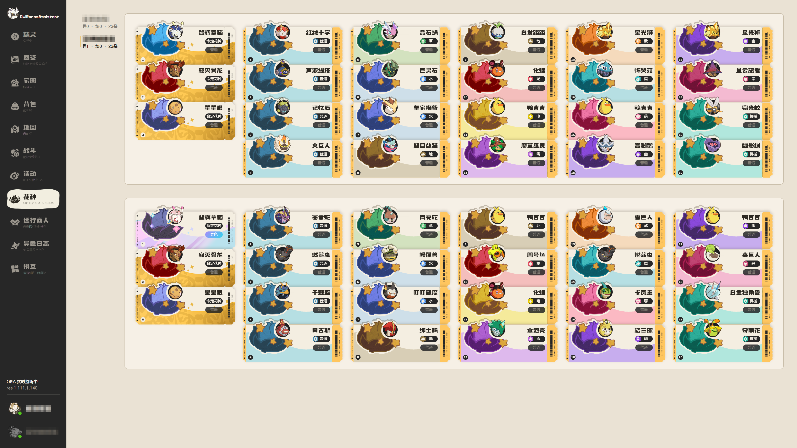

### 异色日志

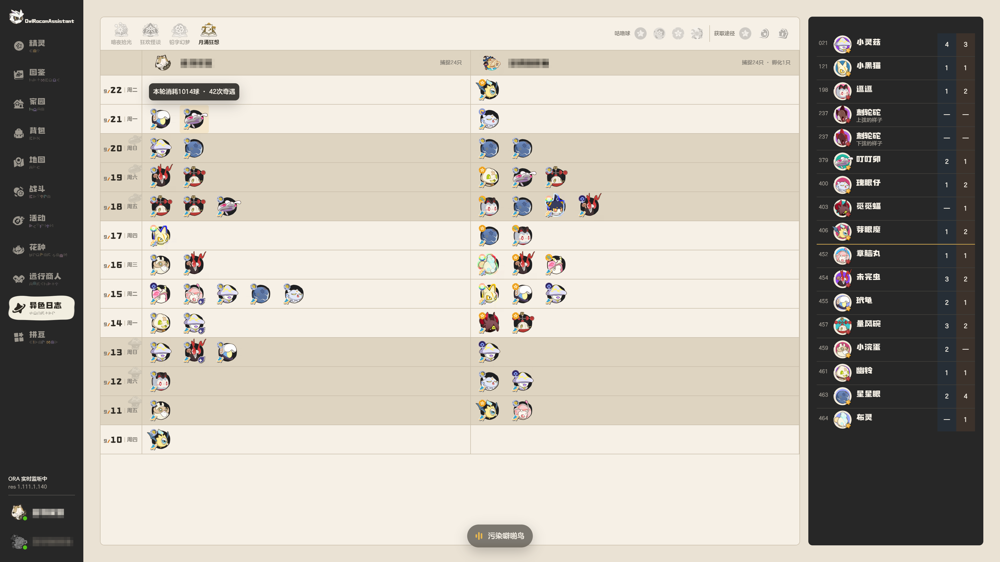

## 本地运行

ORA 在本机运行，页面、服务与实时协议监听均使用本地回环地址。账号配置、个人记录与协议缓存保存在用户自己的设备中。

## 项目状态

ORA 正在持续开发和完善。本仓库用于展示产品界面、功能进展与版本信息，项目开发仓库独立维护。

本项目为玩家制作的辅助工具，与《洛克王国：世界》官方无隶属关系。相关游戏名称、图像和商标归其权利人所有。

\技术交流大欢迎/

© 2026 benzoic-acid. All rights reserved.
